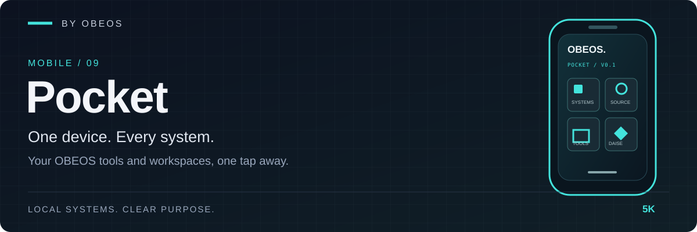

<div align="center">



**One device. Every system. A mobile launchpad for the tools and projects you run.**

[](https://github.com/5K-bit/Pocket/actions/workflows/validate.yml)


</div>

[Overview](#overview) · [Quick start](#quick-start) · [Architecture](#architecture) · [Validation](#validation-and-evidence) · [Limitations](#limitations)

---

## Overview

**Pocket** is the lightweight, installable **mobile entry point to the OBEOS / Blackfong ecosystem**. It puts your existing websites, source repositories, Netlify deployments, learning resources and configured dashboards behind a single Home Screen icon. Its purpose is **access, not automation or remote system control**.

Part of the OBEOS product family (**Mobile / 09**). Pocket is a standalone static Progressive Web App; it needs **no server, account, app-store distribution, build pipeline, or runtime package dependencies** to run. A service worker caches the app shell for offline launch, but external destinations still need their own connectivity.

> **Privacy boundary:** Link edits stay in browser `localStorage` on the current device. They are not encrypted, backed up, or synced; do not put credentials or tokens in destination URLs.

## What it does

| Capability | Current behavior |
|---|---|
| Install on iPhone | Safari **Share → Add to Home Screen**, then open as a web app when offered |
| Launch projects | Open configured OBEOS, GitHub, Netlify, ChatGPT and Legion / DAISE links |
| Customize destinations | **Edit Links** validates HTTPS URLs and saves them locally |
| Open offline | Cached launcher assets work after a successful online load; linked services may not |
| Deploy | Static repository root publishes to Netlify using `netlify.toml` |
| Validate | Node syntax checks and a Python stdlib deployment validator run in GitHub Actions |

**Not provided in v0.2.0:** live service health, authentication to OBEOS APIs, SSH, command execution, synchronized preferences, or notifications.

## Quick start

Use the current Netlify deployment if you have already linked it to this repository's `main` branch. Or serve a local development copy:

```sh
git clone https://github.com/5K-bit/Pocket.git
cd Pocket
python3 -m http.server 8000
# Open http://localhost:8000
```

The service worker registers only over HTTPS (the Netlify deployment). On `http://localhost` the launcher works but is not cached for offline use; opening `index.html` directly from Files also lacks install/offline behavior. `node scripts/acceptance-e2e.cjs` (needs Playwright) serves a copy over local HTTPS and checks offline launch, edits and update behavior.

To deploy from Git: connect the **existing** OBEOS Pocket site in Netlify to **`5K-bit/Pocket`**, production branch **`main`**. The repository sets `[build] publish = "."`; no build command is required. Verify a **Published** deploy and test the same site URL on your iPhone before assuming a push has gone live.

**iPhone source workflow:** clone in Working Copy → edit files → commit and push to `main` → verify Netlify deployment → reopen Pocket. GitHub stores the code; Netlify hosts the site; the iPhone retains its own customized destinations.

## Architecture

```text
Safari / iOS Home Screen
         |
         v
      Pocket PWA
      index.html + styles.css + app.js
         |                    |
         |                    +--> localStorage (editable link destinations)
         |
         +--> service-worker.js --> Cache Storage (offline launcher shell)
         |
         +--> HTTPS links --> OBEOS site / GitHub / Netlify / ChatGPT / custom endpoints
```

This is a **static link launcher**: no external API calls or remote command surface is built into Pocket. Network availability reported by the browser is not the same as service availability.

## Validation and evidence

```sh
node --check app.js
node --check service-worker.js
python3 scripts/validate.py
```

The `Validate PWA` GitHub workflow runs these checks on pushes and pull requests. The validator verifies required assets, icon presence, manifest configuration, Netlify publish root, declared security headers and core source references. **These are static checks**, not automated iPhone/Safari acceptance tests.

| Claim | Evidence |
|---|---|
| Static deploy layout is coherent | [`scripts/validate.py`](scripts/validate.py) and [`netlify.toml`](netlify.toml) |
| Browser source passes syntax checks | [CI workflow](.github/workflows/validate.yml) |
| Local HTTPS destination validation | [`app.js`](app.js) |
| Offline shell and cache replacement behavior | [`service-worker.js`](service-worker.js) |
| App identity and iOS icon references | [`manifest.webmanifest`](manifest.webmanifest), [`index.html`](index.html) |

## Limitations

- **Launcher only.** Pocket does not test if your OBEOS, Legion or DAISE services are reachable, healthy or authorized.
- **Offline means shell only.** GitHub, Netlify and your custom destinations require the relevant network access. A first visit must complete before the shell can be cached.
- **Device-local preferences.** Clearing website data, reinstalling or switching browsers may erase customized destinations.
- **Updates can appear delayed on iOS.** Reopen Pocket while online after a deployment; Safari may keep an older service-worker-controlled page until it is replaced.
- **HTTPS-only is not a trust guarantee.** You choose the destination. Avoid credential-bearing URLs and unauthenticated administrative endpoints.
- **No dedicated iOS end-to-end CI yet.** Validate Home Screen installation, safe-area layout, navigation and offline behavior manually.

## Roadmap

- [x] Installable branded iPhone launcher
- [x] Local destination editor and offline-capable shell
- [x] Static validation and GitHub-driven Netlify deployment configuration
- [ ] Repeatable iOS/Safari acceptance evidence
- [ ] Optional authenticated **read-only** service health
- [ ] Explicitly approved actions via an authenticated, audited OBEOS gateway (later phase; not implemented)

## Development practice

AI tools assist with implementation, debugging, tests and documentation in this project.  
Louis Boddie owns direction and acceptance decisions; linked tests and evidence document what is verified.

## Contributing and security

See [CONTRIBUTING.md](CONTRIBUTING.md) and [SECURITY.md](SECURITY.md). Report vulnerabilities privately using GitHub's security reporting flow if available, rather than posting credentials or exploit details in public issues.

## Brand system

Pocket belongs to the same **“BY OBEOS”** numbered product family as Blackbox, Casefile and ShiftLedger; its product-specific accent is **electric teal**. The editable GitHub banner and GitHub social-preview guidance are in [`assets/brand`](assets/brand/README.md).

**License:** Apache-2.0. See [LICENSE](LICENSE).
